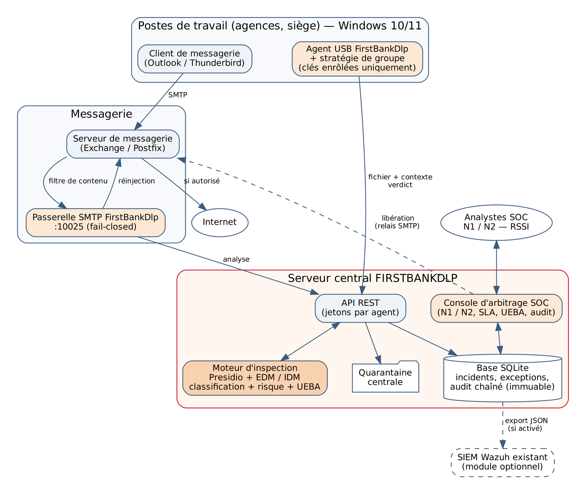
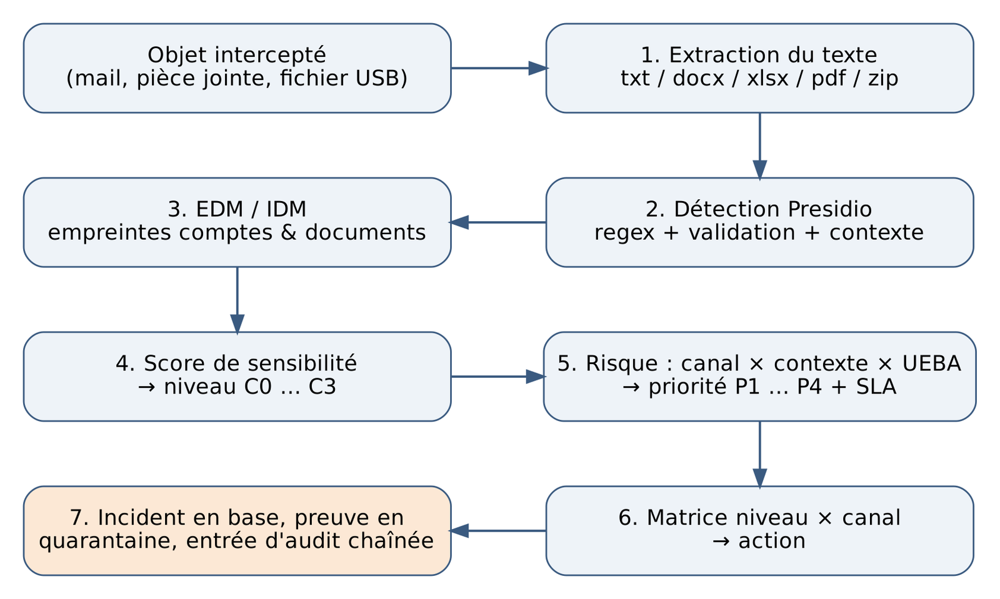
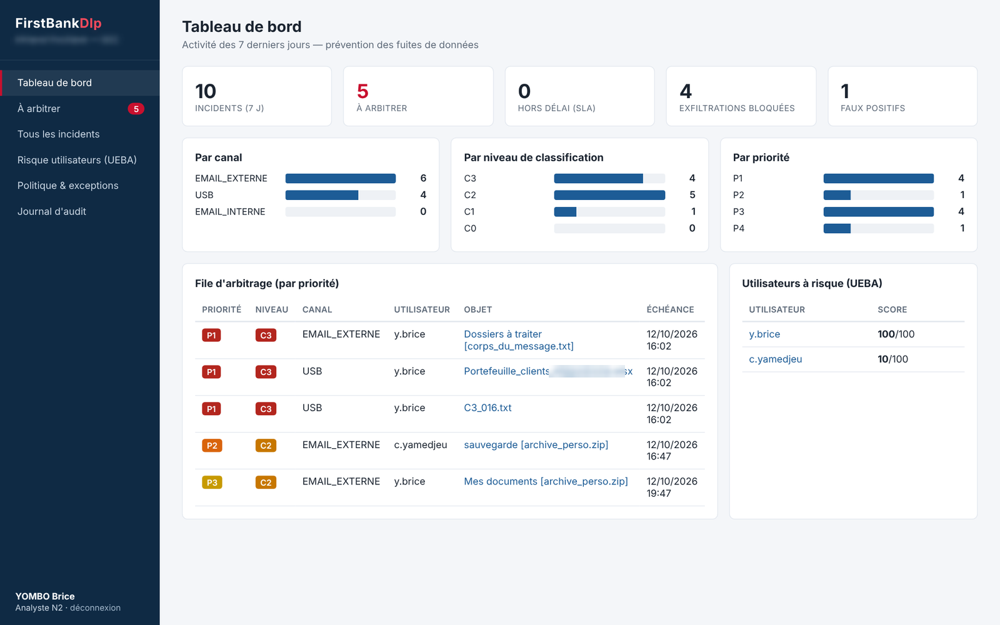
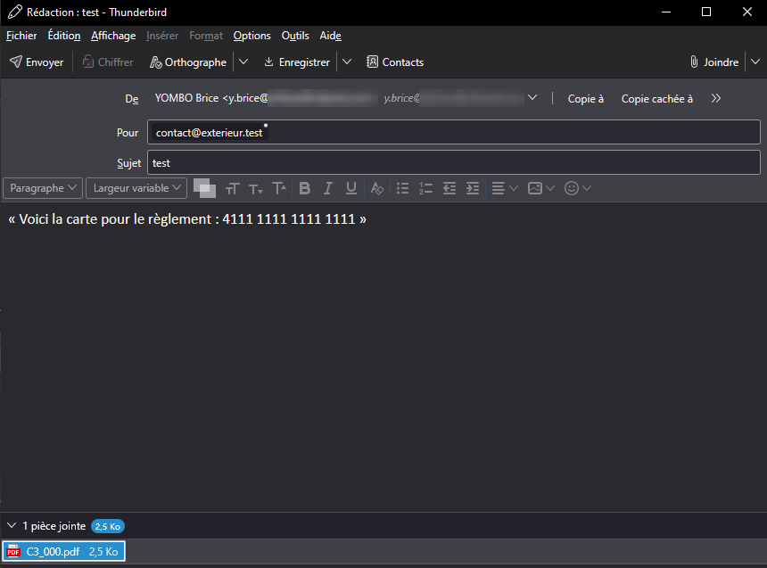
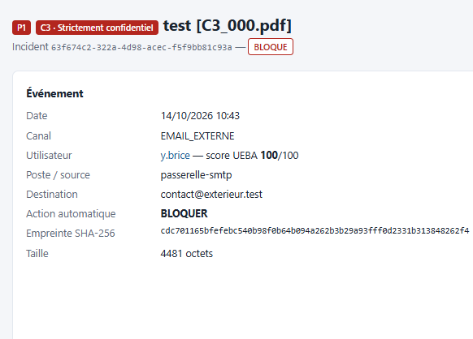
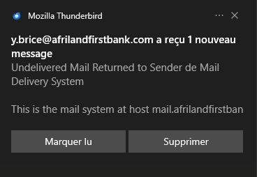
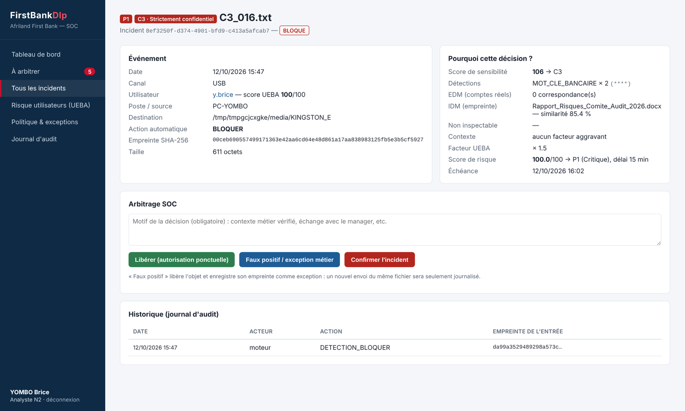
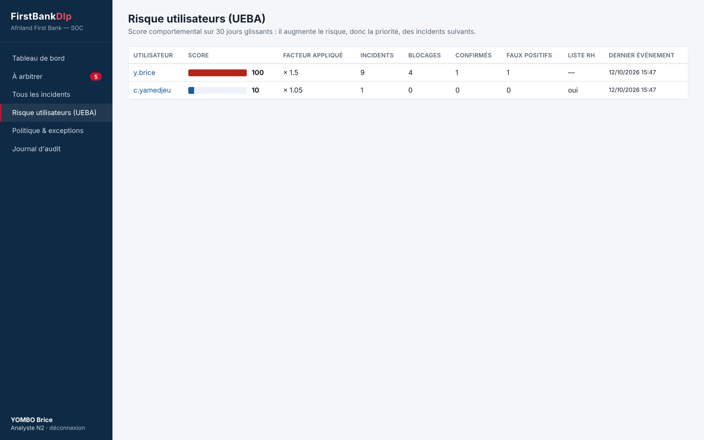
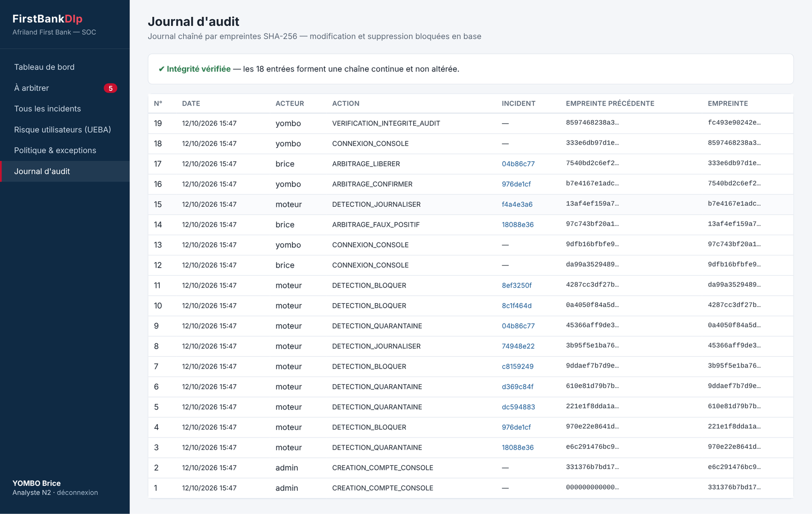
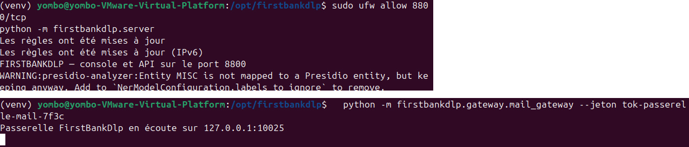

# FirstBankDlp

**Plateforme open source de prévention des fuites de données (DLP) et d'arbitrage SOC pour le milieu bancaire.**

Projet de Master II en sécurité des systèmes d'information (Institut Universitaire Saint Jean, 2026) : *Conception et mise en place d'un système de Data Loss Prevention et d'arbitrage SOC en milieu bancaire.*

**Une solution pensée pour les banques**, en particulier celles de la zone CEMAC. Le nom de l'établissement ayant servi de cadre au projet a été masqué sur les captures.

Auteur : **Brice YOMBO**, analyste SOC junior – [LinkedIn](https://www.linkedin.com/in/brice-yombo) · [TryHackMe](https://tryhackme.com/p/brice_yombo)

> Toutes les données visibles dans les captures sont **fictives** (corpus synthétique). Aucune donnée client réelle n'a été utilisée.

*English summary at the bottom of the page.*

---

## Le problème

Une banque manipule chaque jour des numéros de carte, des IBAN, des portefeuilles clients et des rapports internes. Un simple e-mail mal adressé ou une copie sur clé USB suffit pour provoquer une fuite, et depuis le 23 juin 2026 la loi camerounaise n° 2024/017 sur la protection des données personnelles rend ces fuites encore plus coûteuses.

Les suites DLP commerciales sont chères, et les deux DLP open source historiques (OpenDLP, MyDLP) ne sont plus maintenus depuis plus de dix ans. FirstBankDlp reprend les mécanismes clés des solutions du marché avec des briques open source, pensées pour le contexte de la zone CEMAC.

## Ce que fait la plateforme

- **Inspecte le contenu** des e-mails sortants et des fichiers copiés sur clé USB.
- **Reconnaît les données bancaires de la zone CEMAC** : carte bancaire (contrôle de Luhn), IBAN (mod 97), RIB, NIU, CNI, téléphone, marquages de confidentialité.
- **Compare aux données réelles de la banque** sans les exposer : EDM (comptes clients hachés) et IDM (empreintes de documents sensibles).
- **Classe chaque contenu** sur quatre niveaux, de C0 (public) à C3 (strictement confidentiel), puis calcule un **score de risque** enrichi par l'analyse comportementale des utilisateurs (UEBA).
- **Décide automatiquement** (laisser passer, journaliser, retenir ou bloquer) et attribue une **priorité P1 à P4** avec un délai de traitement (SLA).
- **Laisse le dernier mot au SOC** : une console d'arbitrage à deux niveaux (N1 / N2) permet de libérer, classer en faux positif ou confirmer chaque incident.
- **Trace tout** dans un journal d'audit chaîné par empreintes SHA-256 : toute modification a posteriori est détectée.
- **Reste sûre en cas de panne** : la passerelle mail fonctionne en mode *fail-closed*.
- **Prépare l'intégration au SIEM Wazuh** existant (export JSON et règles, module optionnel).

## Architecture

| Composant | Rôle |
|---|---|
| Moteur d'inspection | Presidio + détecteurs CEMAC, EDM / IDM, classification C0–C3, score de risque, priorité P1–P4 |
| Serveur central (Flask) | API REST des agents, quarantaine centrale, base SQLite, UEBA, console d'arbitrage, journal d'audit chaîné |
| Passerelle SMTP | Filtre de contenu pour Postfix (port 10025), blocage avec avis de non-remise |
| Agent USB | Agent pour postes Windows 10/11, combiné à une stratégie de groupe (clés enrôlées uniquement) |
| Module Wazuh | Export JSON et règles pour le SIEM (optionnel) |

Chaîne de traitement du moteur :

## Captures

### Console SOC : tableau de bord

### Canal e-mail : un numéro de carte envoyé vers l'extérieur
Message de test avec un numéro de carte et un document C3 en pièce jointe :

Le message est bloqué, un incident P1 est créé, et l'expéditeur reçoit un avis de non-remise :

 

### Canal USB : copie bloquée par empreinte documentaire (IDM)

### Analyse comportementale (UEBA)

### Journal d'audit et contrôle d'intégrité

### Démarrage du serveur central et de la passerelle SMTP

## Résultats

Évaluation sur un corpus synthétique de **240 documents étiquetés** (60 par niveau) :

| Indicateur | Avant calibrage | Après calibrage |
|---|---|---|
| Précision sur les documents sensibles (C2 + C3) | 100 % | 100 % |
| Rappel sur les documents sensibles (C2 + C3) | 50 % | **100 %** |
| Faux positifs (C0 / C1 classés C2 / C3) | 0 | **0** |
| Exactitude de classification | 52,1 % | **99,2 %** |
| Latence médiane d'inspection | – | **16 ms** |

Essais de bout en bout sur un laptop de test (serveur Ubuntu, poste Windows 10 avec une vraie clé USB, client Thunderbird) :
- un e-mail contenant le portefeuille clients est bloqué, avec avis de non-remise ;
- un document confidentiel copié sur clé est retenu, puis restitué après arbitrage ;
- la plateforme reste sûre quand le serveur est arrêté ;
- toute falsification du journal d'audit est détectée.

Ces résultats restent à confirmer sur des données réelles d'entreprise.

## Technologies

Python · Microsoft Presidio · spaCy · Flask · SQLite · Postfix / Dovecot · PowerShell · stratégies de groupe Windows · Wazuh · Ubuntu 24.04

## Code source

Le code complet sera publié dans ce dépôt après relecture (retrait des jetons et paramètres de test).

---

## English summary

**FirstBankDlp** is an open source data loss prevention (DLP) and SOC arbitration platform built for the banking sector, as part of my Master's degree in information systems security.

- Content inspection engine based on **Presidio**, extended with recognizers for the CEMAC zone (Luhn-validated card numbers, IBAN, RIB, tax ID, national ID).
- **Exact data matching (EDM)** and **indexed document matching (IDM)**.
- Four-level classification (C0–C3), contextual risk score enriched with **UEBA**, priority P1–P4 with SLA.
- Controls **email** (Postfix SMTP gateway, fail-closed) and **USB drives** (Windows agent + group policies).
- Two-tier (L1 / L2) **SOC arbitration console** with a hash-chained, tamper-evident audit trail.
- Optional integration with the **Wazuh SIEM**.

On a synthetic corpus of 240 documents: **99.2 % classification accuracy, 100 % recall on sensitive documents, zero false positives, 16 ms median latency.** All data shown is synthetic.
